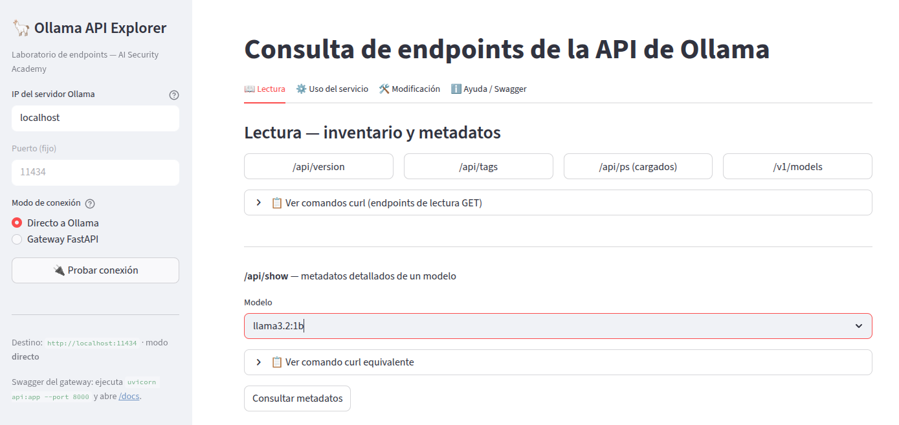
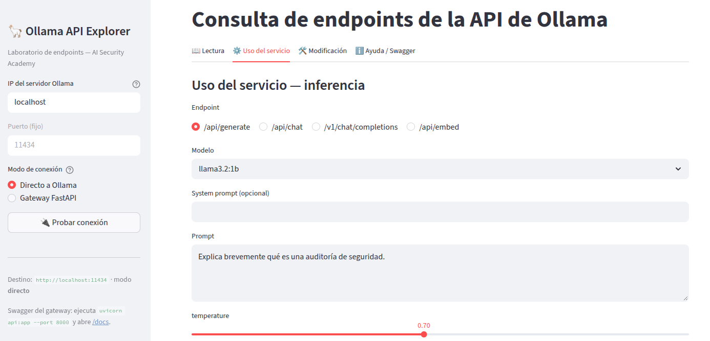
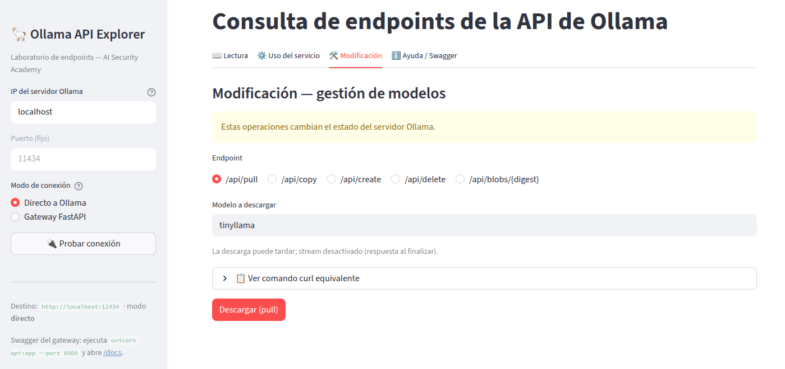
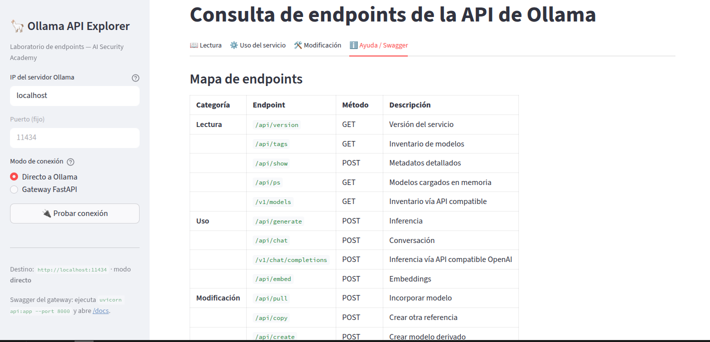

# Ollama API Explorer

Herramienta de laboratorio para **probar los principales endpoints de la API de Ollama**.
Incluye dos interfaces que comparten los mismos modelos Pydantic y el mismo cliente:

- **Streamlit** (`app.py`): interfaz visual por categorías (Lectura / Uso / Modificación),
  con chat para `/api/chat`, formularios para cada endpoint y selector de la IP del servidor.
- **FastAPI + Swagger** (`api.py`): gateway documentado con validación Pydantic y
  **Swagger UI automática en `/docs`** para probar los endpoints manualmente.

El **puerto de Ollama es fijo: `11434`**. La **IP del servidor** se configura en la app
(por defecto `localhost`). **Sin autenticación** (uso en laboratorio).

## Endpoints soportados

| Categoría | Endpoint | Método |
|---|---|---|
| Lectura | `/api/version`, `/api/tags`, `/api/ps`, `/v1/models` | GET |
| Lectura | `/api/show` | POST |
| Uso | `/api/generate`, `/api/chat`, `/v1/chat/completions`, `/api/embed` | POST |
| Modificación | `/api/pull`, `/api/copy`, `/api/create` | POST |
| Modificación | `/api/delete` | DELETE |
| Modificación | `/api/blobs/{digest}` | HEAD/GET |

## Instalación

```bash
pip install -r requirements.txt
```

## Ejecución

**Interfaz Streamlit:**
```bash
streamlit run app.py
```
Abre http://localhost:8501, introduce la IP del servidor Ollama en la barra lateral
(por defecto `localhost`) y prueba los endpoints.

**Gateway + Swagger (en otra terminal):**
```bash
uvicorn api:app --reload --port 8000
```
Abre http://localhost:8000/docs para la documentación Swagger. En cada operación puedes
indicar la IP de Ollama en el parámetro `host`.

> Arranque conjunto: `./run.sh`

## Interfaz

La interfaz Streamlit organiza los endpoints en pestañas. Capturas:

### Lectura — inventario y metadatos


Botones para los endpoints GET (`/api/version`, `/api/tags`, `/api/ps`, `/v1/models`), un
desplegable con los comandos `curl` equivalentes y el formulario `/api/show` para consultar
los metadatos detallados de un modelo. Los resultados se muestran como tabla y, además, en
JSON completo desplegable.

### Uso del servicio — inferencia


Selector del endpoint de inferencia (`/api/generate`, `/api/chat`, `/v1/chat/completions`,
`/api/embed`), elección de modelo, *system prompt* opcional, *prompt* y `temperature`. Para
`/api/chat` se muestra un chat interactivo con historial; cada operación incluye su `curl`.

### Modificación — gestión de modelos


Operaciones que cambian el estado del servidor: `/api/pull` (descargar), `/api/copy`,
`/api/create`, `/api/delete` (con confirmación) y `/api/blobs/{digest}`. En la imagen,
el formulario de `/api/pull` con su `curl` equivalente.

### Ayuda / Swagger


Mapa completo de endpoints (categoría, ruta, método y descripción) e instrucciones para
arrancar el gateway FastAPI y abrir la documentación **Swagger** en `/docs`.

## Modos de conexión en Streamlit

- **Directo a Ollama**: la app llama a `http://<IP>:11434` directamente.
- **Gateway FastAPI**: la app llama al backend FastAPI (que valida con Pydantic y
  expone Swagger); útil para verificar que ambos caminos se comportan igual.

## Archivos

| Archivo | Contenido |
|---|---|
| `app.py` | Interfaz Streamlit |
| `api.py` | Gateway FastAPI (Swagger en `/docs`) |
| `models.py` | Modelos Pydantic de las peticiones |
| `ollama_client.py` | Cliente HTTP de Ollama (puerto fijo 11434) |
| `backends.py` | Abstracción directo / gateway para la interfaz |
| `requirements.txt` | Dependencias |
| `run.sh` | Arranca gateway + Streamlit |
